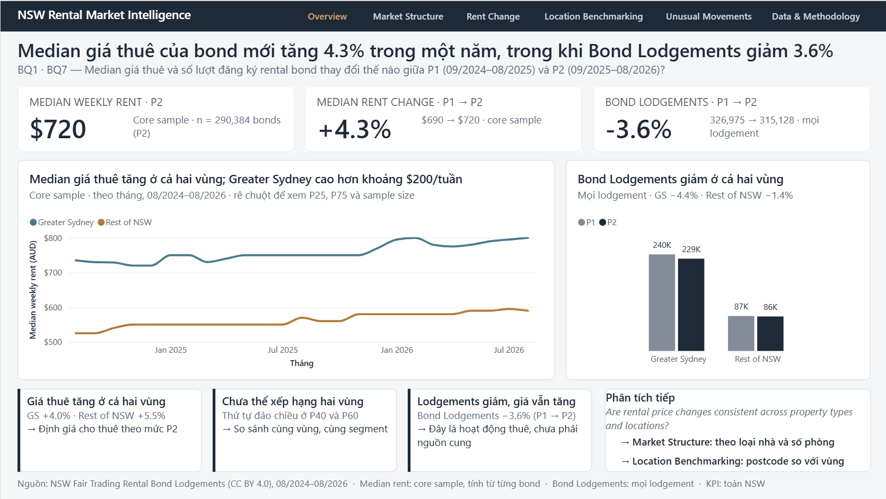
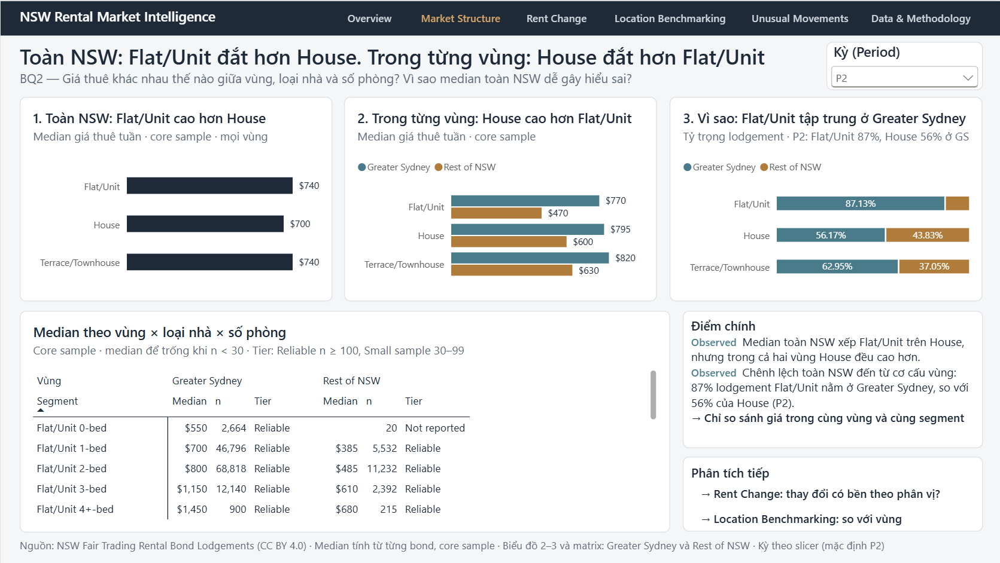
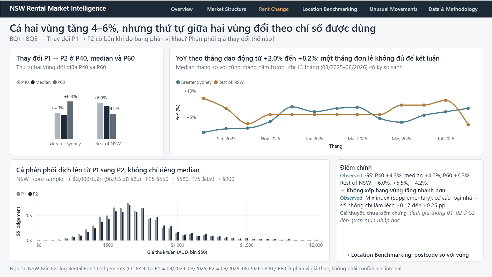
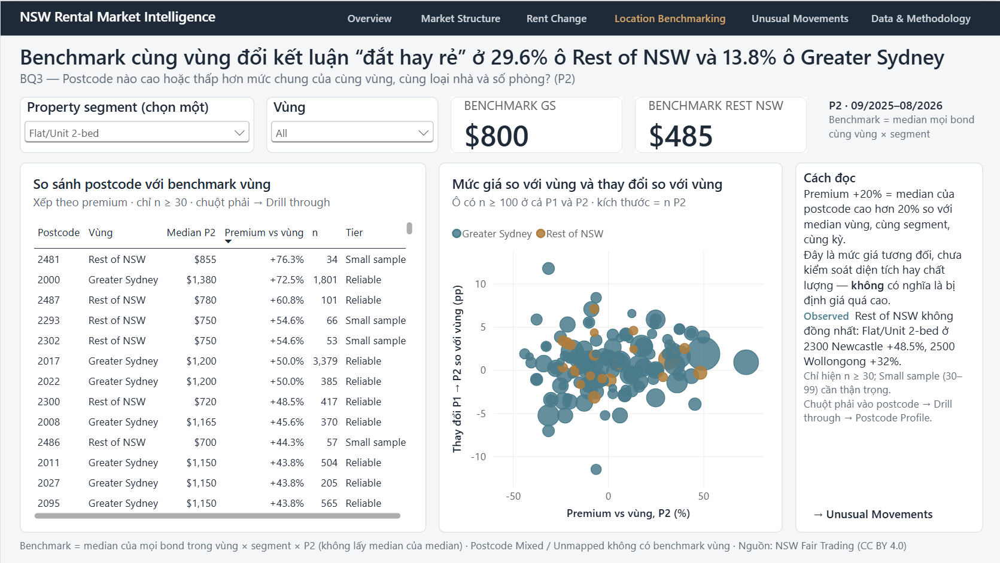
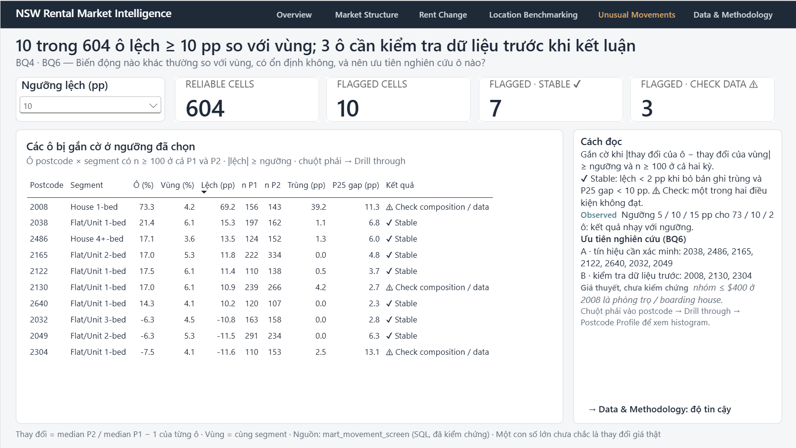
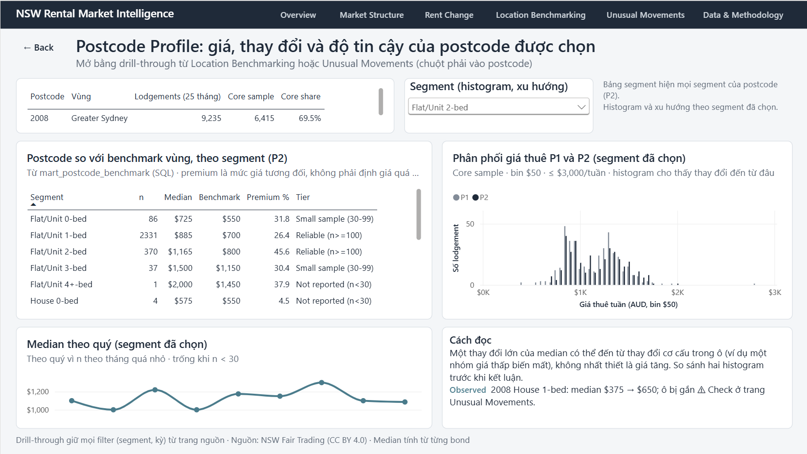
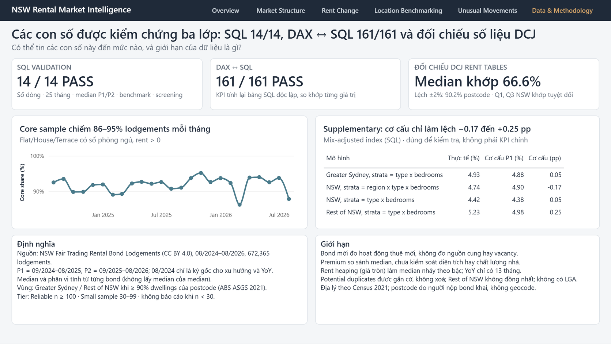

# NSW Rental Market Intelligence — SQL & Power BI

**How can a property consultancy compare rents between areas fairly, spot unusual movements, and know when a number is reliable enough to advise a client?**

This project analyses **672,365 rental bond lodgements** in New South Wales, Australia (Aug 2024 – Aug 2026) with **SQL (DuckDB)** and presents the answers in a **7-page interactive Power BI dashboard**.

## TL;DR

> **Problem:** a property consultancy needs to tell clients whether an area is expensive, and which rent movements are real.
>
> **Finding:** median rent of new tenancies rose **4.35%** while new lodgements fell **3.6%**. Comparing an area with the wrong benchmark is the main risk: houses look cheaper than flats across NSW but cost more inside each region (**Simpson's paradox**), and a state-wide benchmark reverses the "above or below market" answer for **14–30%** of postcode segments.
>
> **Recommendation:** always benchmark an area against its own region and segment; treat the 10 flagged movements as a research shortlist (7 stable signals to verify, 3 data checks first).
>
> **How:** DuckDB SQL over 672,365 lodgements → 7-page Power BI dashboard · 14/14 SQL checks · 161/161 DAX–SQL matches · medians cross-checked against official NSW rent tables.



📄 **[View the dashboard as a PDF](docs/Dashboard_Preview.pdf)** (no Power BI needed) · **[⬇ Download the dashboard (.pbix, 12 MB)](NSW_Rental_Market_Dashboard.pbix)** · [Business questions](docs/Business_Questions.md) · [Findings](docs/Findings_and_Recommendations.md) · [SQL](sql/) · [Methodology](docs/Methodology.md)

> **Language note:** the Power BI dashboard is written in **Vietnamese** (page titles, insights and notes), because it was built for the Vietnamese job market; KPI labels are in English. This README and all documentation are in **English** and explain every page — each screenshot below has an English caption.

---

## Key findings

| | Finding |
|---|---|
| 📈 | **Rents of new tenancies rose +4.35%** across NSW (median $690 → $720 per week, Sep 2024–Aug 2025 vs Sep 2025–Aug 2026). Both regions rose about 4–6%. |
| ⚖️ | **The two regions cannot be ranked.** Rest of NSW looks faster on the median (+5.45% vs +4.0%), but the order reverses on other percentiles. |
| 🔀 | **Simpson's paradox:** across NSW a house looks cheaper than a flat ($700 vs $740), yet inside *each* region houses are more expensive — flats are concentrated in high-rent Sydney. |
| 📍 | **The benchmark matters:** comparing a postcode with its own region instead of all NSW flips the "expensive or cheap?" answer for **29.6%** of Rest of NSW cells and **13.8%** of Greater Sydney cells. |
| 🚩 | **Screening 604 reliable postcode × segment cells** with a 10-percentage-point rule flags **10 movements**: 7 stable signals to verify, 3 that need a data check first (e.g. a +73% rise that halves when potential duplicates are removed). |
| 📉 | **New bond lodgements fell −3.6%** while rents rose (activity, not supply). |

## Recommendations

1. Benchmark every area against the **same region and segment**; an NSW-wide benchmark is wrong for 14–30% of cells.
2. Report rent change as **median with the P40–P60 range** over 12-month periods; avoid single-month YoY.
3. **Do not claim one region is growing faster** — the ranking depends on the statistic.
4. Use the 10 pp screen as a **research shortlist**: verify the 7 stable signals with outside information; check the data for the other 3 first.

Every statement in the project is labelled **Observed** or **Hypothesis**; no root cause is claimed because the data does not contain causes.

---

## Business questions

| # | Question | Page |
|---|---|---|
| BQ1 | How did rents of new bonds change over time? | 1, 3 |
| BQ2 | How do rents differ by region, dwelling type and bedrooms? | 2 |
| BQ3 | Which postcodes are above/below the benchmark of the **same region and segment**? | 4, 6 |
| BQ4 | Which movements are unusual, and are they stable? | 5, 6 |
| BQ5 | Do distribution, rent heaping and property mix change how the trend should be read? | 3, 7 |
| BQ6 | Which areas deserve further research, and why? | 5 |
| BQ7 | How did the number of new lodgements change? | 1 |

## Dashboard tour

| | |
|---|---|
|  **1 · Executive Overview** — median rent of new bonds up 4.3% while lodgements fell 3.6%; monthly trend by region |  **2 · Market Structure** — the Simpson's paradox: flats cost more across NSW, houses cost more within each region |
|  **3 · Rent Change & Distribution** — both regions rose 4–6%, but their order changes with P40 / median / P60; YoY and rent histogram |  **4 · Location Benchmarking** — each postcode vs its regional benchmark (same segment), with sample size and reliability tier |
|  **5 · Unusual Movements** — threshold slicer (5/10/15 pp), stable vs "check data" flags, research priorities |  **6 · Postcode Profile** (drill-through) — one postcode's segments vs benchmark, rent histogram P1 vs P2, quarterly trend |
|  **7 · Data & Methodology** — three validation layers (SQL 14/14, DAX↔SQL 161/161, official DCJ figures), definitions and limitations | |

**Design choices:** every median is shown with its sample size and reliability tier · only built-in visuals · no maps, dual axes or multi-slice pies · action titles state the verified insight · a drill-through page for investigation · slicers only where they do not break period KPIs.

## How to open the dashboard

1. Install **Power BI Desktop** (free, Windows). The file was saved with the October 2026 release; use that version or newer.
2. Download [`NSW_Rental_Market_Dashboard.pbix`](NSW_Rental_Market_Dashboard.pbix) (or the file attached to the latest Release) and open it.
3. The data is embedded — **no refresh, database, Python or sign-in is needed**. (Clicking *Refresh* will fail because the source folder is not part of this repository.)
4. In Power BI Desktop, hold **Ctrl** while clicking the navigation buttons. Right-click a postcode on pages 4 or 5 → **Drill through → Postcode Profile**.

## SQL highlights — five queries, five business answers

The SQL in [`sql/`](sql/) is published unchanged from the project (DuckDB). These five queries carry the main business story; the other files are supplementary technical documentation (staging, regional marts, validation) described in the [SQL guide](sql/README.md).

**1 · Is a house cheaper than a flat? — Simpson's paradox** ([bq2_market_structure.sql](sql/business_questions/bq2_market_structure.sql), `bq2_region_type`)
```sql
SELECT dwelling_type,
       MAX(CASE WHEN geography = 'NSW'            THEN median_rent END) AS nsw_median,
       MAX(CASE WHEN geography = 'Greater Sydney' THEN median_rent END) AS greater_sydney_median,
       MAX(CASE WHEN geography = 'Rest of NSW'    THEN median_rent END) AS rest_of_nsw_median
...
```
→ Across NSW a house looks cheaper ($700 vs $740); inside each region it is more expensive. Advice must compare within a region.

**2 · Is this postcode expensive compared with comparable areas?** ([06_postcode_benchmark.sql](sql/06_postcode_benchmark.sql), `mart_postcode_benchmark`)
```sql
100.0 * (c.median_rent / b.median_rent - 1) AS premium_pct
...
JOIN mart_region_segment AS b
  ON  b.geography     = c.region
  AND b.dwelling_type = c.dwelling_type
  AND b.bedroom_band  = c.bedroom_band
  AND b.period        = c.period;
```
→ Each postcode is compared only with its own region, same dwelling type × bedrooms and period; the benchmark is the median of all lodgements, never a median of medians.

**3 · Does the choice of benchmark change the advice?** ([bq3_location_benchmarking.sql](sql/business_questions/bq3_location_benchmarking.sql), `bq3_benchmark_choice_effect`)
```sql
COUNT(CASE WHEN SIGN(median_rent - nsw_benchmark) <> SIGN(median_rent - region_benchmark) THEN 1 END) AS cells_changing_side
```
→ Yes: the "above / below benchmark" answer flips for 29.6% of Rest of NSW cells and 13.8% of Greater Sydney cells.

**4 · Which movements are unusual — and can we trust them?** ([07_unusual_movements.sql](sql/07_unusual_movements.sql), `mart_movement_screen`)
```sql
CASE
    WHEN ABS(deviation_pp) < 10 THEN 'In line with region'
    WHEN dup_sensitivity_pp < 2 AND p25_gap_pp < 10 THEN 'Unusual - stable'
    ELSE 'Unusual - check composition / data'
END AS screen_result
```
→ Only cells with n ≥ 100 in both periods are screened; 10 of 604 are flagged, 7 of them stable.

**5 · Where should the team research next?** ([bq6_decision_support.sql](sql/business_questions/bq6_decision_support.sql), `bq6_research_shortlist`)
```sql
CASE screen_result
    WHEN 'Unusual - stable' THEN 'A. Market signal to verify'
    ELSE 'B. Data / composition check first'
END AS priority
```
→ A prioritised shortlist with a plain-English reason per row, so a flag becomes a next action rather than a conclusion.

## Validation

| Layer | Result |
|---|---|
| SQL validation checks ([09_validation.sql](sql/09_validation.sql)) | **14 / 14 PASS** |
| Power BI (DAX) vs independent SQL, on the published `.pbix` | **161 / 161 PASS** |
| External check vs official NSW DCJ Rent Tables (same bond source) | Median identical for 66.6% of comparable postcodes, within ±2% for 90.2% |

Details: [Methodology § Validation](docs/Methodology.md#8-validation).

## Data model

Import-mode star schema: `fact_lodgements` (672,365 rows) with `dim_date`, `dim_period`, `dim_postcode` (region), `dim_segment`, two pre-computed marts for benchmarking and screening, and a disconnected `Threshold` table for the 5/10/15 pp slicer. 32 DAX measures; medians are computed from fact rows, never from aggregated tables.

## Limitations

New bonds only (not supply, vacancy or all current rents) · no property or lodgement ID, so duplicates are flagged rather than removed · rent heaping · YoY for 13 months only · premium is not quality-adjusted · Rest of NSW is heterogeneous · 2021 geography, no LGA. Dashboard-specific limitations (for example, a few n < 30 values visible on the drill-through page) are listed in [docs/Limitations.md](docs/Limitations.md).

## Repository contents

```
├── README.md
├── NOTICE.md                          data sources, attribution and licensing
├── NSW_Rental_Market_Dashboard.pbix   Power BI dashboard (7 pages)
├── screenshots/                       one image per page
├── sql/                               selected DuckDB SQL + guide
└── docs/
    ├── Business_Questions.md          problem, users, requirements, BQ → page map
    ├── KPI_Dictionary.md              every KPI with formula, grain and caveats
    ├── Methodology.md                 data, periods, regions, benchmark, screening, validation, model
    ├── Findings_and_Recommendations.md
    └── Limitations.md
```

**Tools:** SQL (DuckDB) · Power BI Desktop (Power Query, DAX, star schema) · Python was used privately for data ingestion and automated tests and is not part of this repository.

## Data sources and licence

- **Data:** NSW Fair Trading — Rental Bond Lodgements, © State of New South Wales, CC BY 4.0 · Australian Bureau of Statistics — ASGS Edition 3 and Census 2021 Mesh Block Counts, CC BY 4.0. Full attribution and conditions in [NOTICE.md](NOTICE.md).
- **Project work** (SQL, documentation, dashboard design): no open-source licence has been applied yet — see [NOTICE.md](NOTICE.md#project-work). The third-party data keeps its own CC BY 4.0 terms.

## About me

- **Education:** Bachelor of Information Technology — Information Systems & Business Analysis
- **Career goal:** Junior Data Analyst

This project is my end-to-end portfolio piece: framing business questions, analysing the data with SQL, validating every number, and communicating the results in a Power BI dashboard with clear, evidence-based recommendations.
